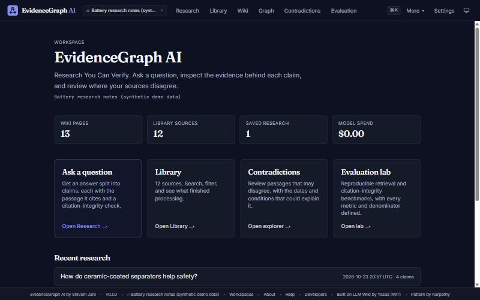
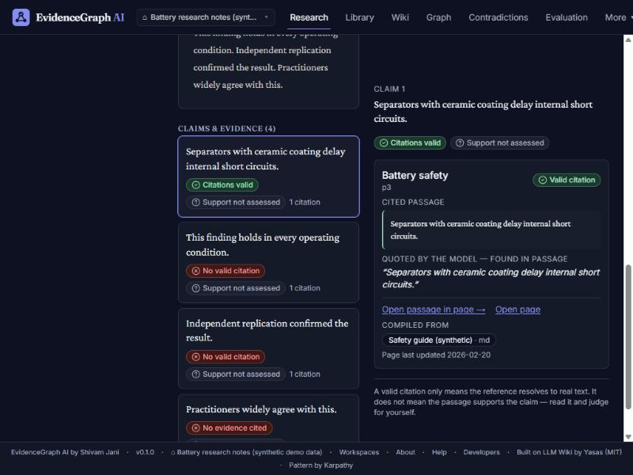
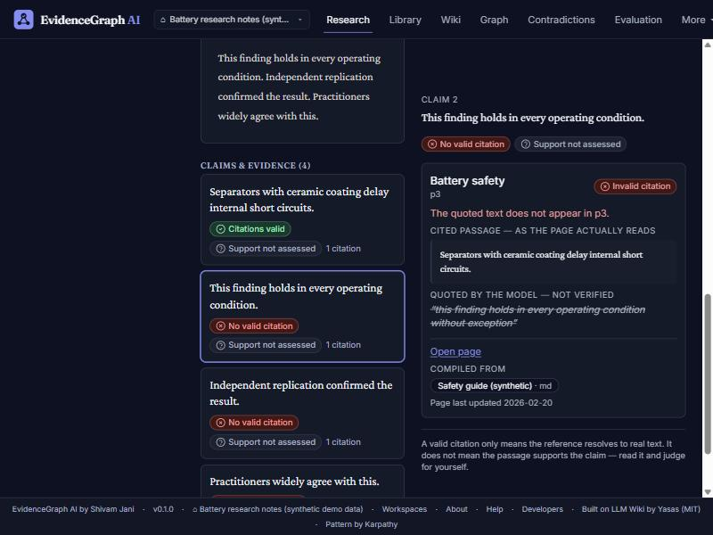
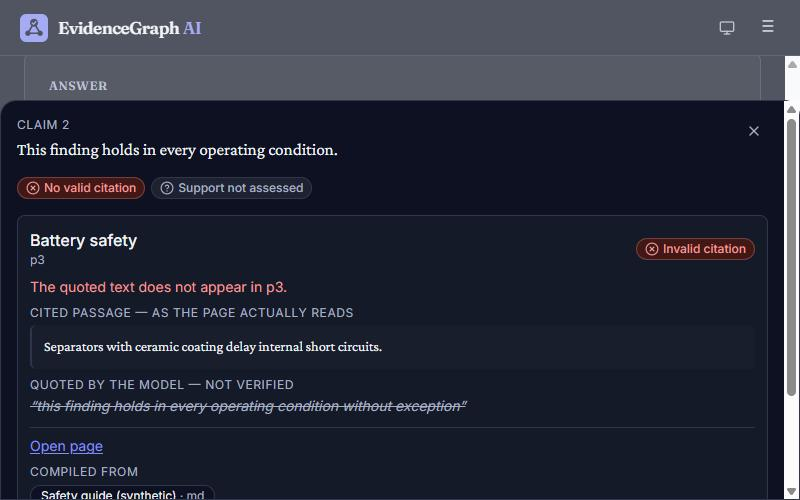
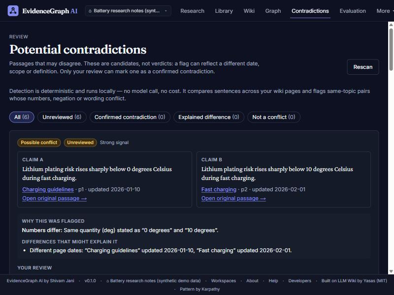
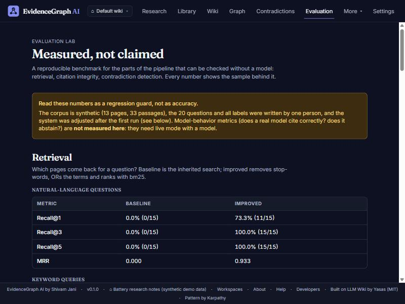
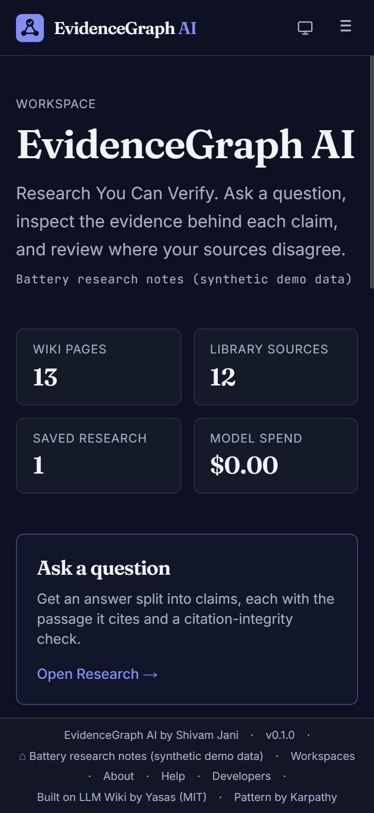
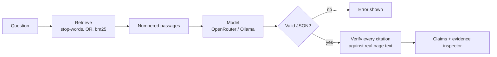

<p align="center">
  
</p>

<h1 align="center">EvidenceGraph AI</h1>

<p align="center">
  <strong>Research You Can Verify.</strong><br>
  An evidence-first, local-first AI research workspace: ask questions of your own sources, inspect the exact passage behind every claim, and review where your sources disagree.
</p>

<p align="center">
  Open source · MIT · Local-first · Bring-your-own-key · v0.1.0 (early, portfolio project)
</p>

> **Status:** a local development project. The source is published in this GitHub repository; it is **not deployed** anywhere and has no production use. Everything below describes what exists in this repository today; limitations and unmeasured areas are listed explicitly.
>
> **Provenance:** EvidenceGraph AI is a derivative of [LLM Wiki](https://github.com/ddsyasas/llm-wiki) by Yasas (MIT). The ingestion pipeline, wiki engine and much of the scaffolding are inherited; the evidence layer, contradiction explorer, evaluation lab and redesign are new. See [Inherited vs. new](#inherited-vs-new) and [`NOTICE.md`](NOTICE.md).

---

## Why

Asking an AI about your documents usually ends with a fluent answer and some citations. Whether those citations are real is left to you: models invent page names, paste quotations that appear nowhere in the source, and cite real text that says something else.

EvidenceGraph AI makes verification part of the answer:

- The model must cite **a page, a passage and a verbatim quote** for each claim.
- Each citation is checked, deterministically, against the real page text.
- Missing, fabricated, or since-deleted evidence is shown plainly — never hidden behind a confident answer.
- Whether a passage actually **supports** a claim is shown as *not assessed*, not guessed. A valid citation is not proof.

## Screenshots

All screenshots use the bundled **synthetic** demo data (`pnpm demo`) and a mock model, so no real documents or API calls are involved.

| | |
|---|---|
|  |  |
| *Dashboard: real counts and recent research* | *A claim with a valid citation: cited passage, verified quote, source lineage* |
|  |  |
| *A fabricated quote struck through next to what the page actually says* | *Narrow screens: the inspector becomes a sheet* |
|  |  |
| *Contradiction explorer: both claims, why flagged, what might explain it, your review* | *Evaluation lab (top of page; it also has a held-out section lower down, not pictured)* |
|  | |
| *Phone width* | |

## Features

**New in EvidenceGraph AI**

- **Research workspace** (`/query`): answers split into claims; per-claim evidence inspector; verdict banner; saved research history you can reopen (evidence is re-verified against the wiki *as it is now*).
- **Citation-integrity validator** (`packages/core/src/evidence.ts`): states *valid*, *invalid*, *evidence unavailable*; handles malformed output, hallucinated pages, deleted pages, wrong passages, fabricated quotes, duplicates and path-traversal slugs. Every state is unit-tested.
- **Passage addressing and deep links**: pages are split into stable passages (`p1`, `p2`…); "Open passage in page" highlights the cited text in context; "Compiled from" links to the raw sources.
- **Contradiction explorer** (`/contradictions`): deterministic, local, free. Shows both claims, why they were flagged, and differences (dates, stated conditions) that may explain them. Every result is a *possible* conflict; only your review marks one confirmed. Reviews persist.
- **Evaluation lab** (`/evaluation`, `pnpm eval`): labeled synthetic benchmark; metrics with defined denominators; frozen first-run record; limitations stated.
- **Library improvements**: search, type and status filters, clear status badges, empty states, no absolute paths shown.
- **Ingestion hardening**: size limits, URL scheme check, extension allowlist.
- **Redesign**: new identity, status colors measured at ≥ 5.9:1 contrast, keyboard focus states, skip link, responsive layouts.

**Inherited from LLM Wiki** (kept, not rebuilt): multi-format ingestion (Markdown, text, HTML, URL, PDF, DOCX, PPTX, XLSX, images), the markdown wiki with backlinks and history, FTS5 search, source lineage, lint, 3D graph, chats, multi-wiki switching, cost tracking, OpenRouter and Ollama providers.

## How verification works



| Question | Answered by |
|---|---|
| Does the citation resolve? (page exists, passage exists, quote really appears) | Deterministic code, tested |
| Does the passage support the claim? | **Not decided.** Shown as "Support not assessed". |

Details: [`docs/evidencegraph/architecture.md`](docs/evidencegraph/architecture.md).

## Evaluation (actual, reproducible results)

```bash
pnpm eval            # development set: deterministic, offline, no model call
pnpm eval --heldout # the separate held-out set
pnpm eval:check     # fails if either set's results drift from the committed files
```

Two small synthetic benchmarks, both written by the project's author:

- **Development set** (13 pages, 20 questions, 24 labeled citations, 5 gold contradictions). The implementation was adjusted while looking at it.
- **Held-out set** (18 pages in a different domain, 30 questions, 160 labeled citations, 7 gold contradictions). Written after development stopped, fixtures hash-pinned, run **once** before any change. It is held out from *tuning*; it is **not an independent benchmark**, because the same person wrote it and built the system.

| | Dev set | Held-out, first run | Held-out, after fixes |
|---|---|---|---|
| Page Recall@3, natural-language questions (inherited search: 0% on both) | 100% (15/15) | 95.5% (21/22) | 100% (22/22) |
| Citation-integrity accuracy (slug-exists baseline: 83.3% / 65.0%) | 100% (24/24) | 100% (160/160) | 100% |
| Contradiction recall / precision | 100% (5/5) / 83.3% | 57.1% (4/7) / 100% | 71.4% (5/7) / 100% |
| Abstention-signal accuracy | 100% | 80.0% (24/30) | 80.0% |

**Read these carefully.**

- The held-out first run exposed two real defects (word endings in the search query; "the 2019 level" parsed as a quantity). Both were fixed, so the "after fixes" column is no longer held out for them. The fix slightly lowered the dev set's keyword Recall@1 (73.3% to 66.7%, one question).
- Two conflicts are still missed (they need synonyms or vocabulary the detector lacks), and the abstention signal's threshold did not generalize, so it is **not** used as a gate.
- 100% citation integrity measures completeness against failure types the validator was designed for, not how often real models fail.
- The inherited search requires *every* word of a question (including "what" and "the") to match, which is why its natural-language score is 0%.
- **No live-model results exist yet**, and semantic support is not measured at all. First-run records are frozen in [`packages/eval/results/`](packages/eval/results/).

Definitions, denominators, the held-out protocol and limitations: [`docs/evidencegraph/evaluation.md`](docs/evidencegraph/evaluation.md).

## Technology

| Layer | Choice |
|---|---|
| Language / framework | TypeScript (strict), Next.js 14 App Router, React 18 |
| UI | Tailwind CSS, shadcn-style primitives, lucide icons, Fraunces / Crimson Pro / Inter |
| Storage | Markdown files + SQLite (`better-sqlite3`) with FTS5; user data (research history, contradiction reviews) as validated JSON files |
| AI | OpenRouter (cloud, BYOK) or local Ollama through the `openai` SDK |
| Validation | `zod` at every model boundary |
| Tests | `vitest` (no network, no model calls) |
| Monorepo | pnpm workspaces: `apps/web`, `packages/core`, `packages/ingestion`, `packages/llm`, `packages/eval` |

## Quick start

**Requirements:** Node.js **20 or 22 LTS** and pnpm 10 (`corepack enable`, or `npm i -g pnpm`). On Windows, a non-LTS Node (e.g. 23) has no prebuilt `better-sqlite3` binary and would need Visual Studio C++ build tools — use an LTS release. To use Node 22 for one PowerShell window without uninstalling anything or changing the system PATH, see [`docs/evidencegraph/publishing.md`](docs/evidencegraph/publishing.md#0-before-anything-else).

```bash
pnpm install
```

**Try it with no API key** (synthetic data, mock model):

```bash
pnpm demo                      # then open http://localhost:3000/query
pnpm demo --mode flawed        # mock also makes bad citations, so the warning states are visible
```

The mock is a deterministic stand-in, **not a language model**; the demo never touches your real wiki or `~/.llm-wiki`.

**Use it for real:**

```bash
pnpm dev                       # http://localhost:3000
```

The first-run wizard asks for a wiki topic and a provider: an OpenRouter key (stored in your OS keychain) or a local [Ollama](https://ollama.com) server. Then add sources in **Library** and ask questions in **Research**.

### Configuration

See [`.env.example`](.env.example). Nothing is required.

| Variable | Purpose |
|---|---|
| `EVIDENCEGRAPH_PATH` | Wiki folder to use (older `LLM_WIKI_PATH` still works) |
| `EVIDENCEGRAPH_PORT` | Port for the packaged CLI |
| `OLLAMA_BASE_URL` | Local Ollama server (default `http://localhost:11434`) |
| `OPENROUTER_API_KEY` | Read **only** by `pnpm eval --live` |
| `EVIDENCEGRAPH_OPENROUTER_API_KEY` | Optional: the app's key, for a server with no OS keychain. When set it is never stored and cannot be changed from Settings. Otherwise the app uses the OS keychain |
| `EVIDENCEGRAPH_ALLOW_PRIVATE_URLS` | Set to `1` to let URL ingestion fetch private and local addresses (blocked by default) |

### Commands

| Command | Does |
|---|---|
| `pnpm dev` | Run the app |
| `pnpm demo` | App + synthetic wiki + mock model |
| `pnpm test` | All tests (350 passing, 1 skipped live-API smoke test) |
| `pnpm typecheck` / `pnpm lint` | Type check / lint |
| `pnpm build` | Production build |
| `pnpm eval` / `pnpm eval --heldout` | Development / held-out evaluation |
| `pnpm eval:check` | Fails if either set's committed results drift |
| `pnpm eval --live --model <slug>` | Run a real model on the fixture questions (sends them to your provider; may cost money). Setup: [live mode](docs/evidencegraph/evaluation.md#live-mode) |
| `pnpm eval --live --mock` | Offline check of the live runner using the mock model (not a model result) |

## Privacy and security

- Files stay on your machine. When you ingest, ask, chat or lint, the relevant text is sent to **the provider you configured** (OpenRouter, or your local Ollama). The UI says so where it matters. No telemetry, analytics or update pings.
- Model output and imported documents are treated as untrusted: zod validation; per-claim parsing; model-supplied slugs are allowlisted before they can reach a path; the query prompt tells the model to ignore instructions inside page text, and the model has no tools.
- Uploads over 25 MB, pasted text over 2 MB and fetched pages over 10 MB are rejected; only http(s) URLs are fetched.
- No authentication — it binds to localhost; don't expose the port.

Details and remaining risks: [`SECURITY.md`](SECURITY.md).

## Known limitations

- **Support is not assessed.** A valid citation proves the reference resolves, not that it supports the claim.
- Evidence lives at wiki-page level; the raw source behind a page is shown as lineage, not as a verbatim quote of the original file.
- Contradiction detection is lexical (numbers, negation, opposites). It misses paraphrased conflicts and flags similar-sounding but unrelated statements (one such false positive is in the benchmark).
- The benchmark is small, synthetic and single-author; live-model behavior is unmeasured.
- Chat and ingest still use the inherited keyword search; only Research uses the new retrieval.
- Passage ids are positional and can shift when a page is edited (citations carrying a quote are re-verified, so drift shows as a mismatch).
- URL ingestion refuses private and local addresses (set `EVIDENCEGRAPH_ALLOW_PRIVATE_URLS=1` to ingest from your own network). It cannot stop DNS rebinding, and the app still has no login, so do not expose it to a network.
- Tested on Windows 11 with Node 22 LTS. Not tested on macOS/Linux in this phase; the upstream project reports it works there.
- A CI workflow exists (`.github/workflows/ci.yml`) and starts running with the first push to GitHub. Its steps were simulated locally from a clean install in a renamed folder; this README does **not** claim it passes, so check the repository's Actions tab for the actual result. No Docker image; not published to npm.

## Roadmap

1. Run live mode across several models and record the results.
2. A larger, human-labeled *support* set; evaluate a model-based support assessor before showing any score.
3. Move chat and ingest onto the new retrieval, with their own evaluation.
4. Model-assisted contradiction scan, with quote validation.
5. Watch the first CI run on GitHub and fix whatever it shows (it targets Node 20 and 22; only 22 has been exercised locally).

## Inherited vs. new

| | Inherited from LLM Wiki (Yasas, MIT) | Added by Shivam Jani |
|---|---|---|
| Ingestion, wiki engine, SQLite/FTS, model client | ✔ | |
| Chats, lint, graph, multi-wiki, costs, CLI, onboarding | ✔ | |
| Passage model, citation validator, claims in the query prompt, retrieval | | ✔ |
| Research workspace, evidence inspector, research history | | ✔ |
| Contradiction explorer and review state | | ✔ |
| Evaluation lab, fixtures, mock model, demo | | ✔ |
| Library search/filters, ingestion limits, path hiding | | ✔ |
| Rebrand, redesign, logo, docs | | ✔ |

## Documentation

[`docs/README.md`](docs/README.md) indexes everything: [audit](docs/evidencegraph/audit.md) · [architecture](docs/evidencegraph/architecture.md) · [evaluation](docs/evidencegraph/evaluation.md) · [deployment assessment](docs/evidencegraph/deployment.md) · [interview guide](docs/evidencegraph/interview-guide.md) · [NOTICE](NOTICE.md). The files `docs/01-*` to `docs/14-*` are the inherited upstream design record.

## Developer

**Shivam Jani** — Computer Science student, full-stack & AI developer
GitHub: [Chico2118](https://github.com/Chico2118) · LinkedIn: [shivam-jani](https://www.linkedin.com/in/shivam-jani-414386313) · shivam21jani@gmail.com

## Credits and license

MIT — see [`LICENSE`](LICENSE) (Copyright (c) 2026 Yasas; Copyright (c) 2026 Shivam Jani for the modifications).

Built on [LLM Wiki](https://github.com/ddsyasas/llm-wiki) by **Yasas**, which implements the pattern described by **Andrej Karpathy** in his [LLM Wiki gist](https://gist.github.com/karpathy/442a6bf555914893e9891c11519de94f). Not affiliated with either of them or with Anthropic. Third-party libraries are used under their own licenses ([`NOTICE.md`](NOTICE.md)).
