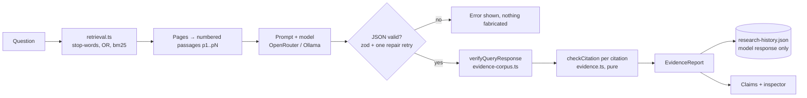

# EvidenceGraph AI — architecture and decisions

This describes the parts added on top of the inherited LLM Wiki architecture (see [`../02-architecture.md`](../02-architecture.md) for the original) and why they are built the way they are.

## Layers

```
apps/web  (Next.js 14, UI + API routes)           ← presentation + HTTP boundary
   │   uses
packages/eval      labeled fixtures, metrics, runners, mock model      ← measurement
packages/core      wiki I/O, SQLite, ingest/query/lint, EVIDENCE LAYER ← domain
packages/ingestion extractors + input limits                           ← untrusted input
packages/llm       OpenRouter/Ollama client, retries, JSON repair      ← AI integration
```

Dependencies point downward only. The evidence layer has no UI imports; the UI imports **types** from core (erased at build) and receives data from API routes, so the browser bundle never contains the SQLite or filesystem code.

## Data flow: one research question



1. **Retrieve** (`retrieval.ts`). The question is reduced to content words, turned into a safe FTS5 OR query with prefix matching and ranked with bm25. Pages are cut into passages; the best-scoring passages that fit a word budget go into the prompt, in reading order. Passage ids always come from the *full* page.
2. **Ask** (`prompts/query.ts`, `query.ts`). Each passage is labeled `[pN]`. The model must return claims, each with citations `{page, passage, quote}`. The prompt tells it to treat page text as data, not instructions.
3. **Validate the shape** (`schema.ts`). The response schema is strict about `answer` and `confidence` and **loose** about `claims` (`unknown`) and about the slugs in `pagesUsed` (any string). That is intentional: `callLLM` never retries a schema failure, so a malformed claim, a malformed `claims` container, or a slug like "Battery Safety" would otherwise discard an otherwise readable answer. The failure-mode tests found exactly these two cases; unusable entries are now reported as malformed or "Not found" instead.
4. **Verify** (`evidence-corpus.ts` → `evidence.ts`). The cited pages are loaded once, then a pure function checks every citation. If the model returned no structured claims, claims are derived from the answer's `[[slug]]` links and marked `origin: "derived"`.
5. **Persist** (`research-history.ts`). Only the model's response is stored. Reopening a run re-verifies against the wiki **as it is now**, so a page edited or deleted afterward shows up honestly.
6. **Render**. The UI shows a verdict banner, the answer, a claim list, and an inspector for the selected claim.

## Citation integrity vs semantic support

| Question | Who decides | Where |
|---|---|---|
| Does the citation resolve? (page, passage, quote) | Deterministic code | `evidence.ts` — tested |
| Does the passage support the claim? | Not decided. Every claim reports `support: not_assessed`. | UI says so explicitly |

Integrity states per citation: **valid**, **invalid** (malformed, bad slug or passage id, passage missing, quote missing or in a different passage), **unavailable** (page deleted or unreadable). Warnings never change the verdict: page-level-only, passage inferred from a quote, quote too short, duplicate.

Claim-level states: `all_citations_valid`, `some_citations_valid`, `no_valid_citations`, `no_evidence`. Overall verdict: `all_claims_verified`, `some_claims_unverified`, `no_valid_evidence`, `no_claims`.

Design points worth being able to explain:

- **Validation is pure.** `validateEvidence(claims, corpus)` takes a pre-loaded `Map` and does no I/O, which makes every failure mode a one-line unit test and makes the evaluation hermetic.
- **Slugs are untrusted.** A slug becomes a file name (`wiki/<slug>.md`). It is checked against `^[a-z0-9-]{1,100}$` in the validator *and again* in the loader; tests cover `../../etc/passwd`, backslashes and embedded `..`.
- **"No claims" is not a failure.** An honest "the wiki doesn't cover this" must not be punished. A low-confidence, uncited answer with no pages used is treated as abstention; a *confident* uncited answer is not.
- **Confidence mismatch.** If the model says "high" but the evidence is not fully verified, the UI says so. Self-reported confidence is never shown as evidence.
- **Quote matching** ignores case, markdown, wikilink syntax, quote/dash styles, punctuation and ellipsis gaps, but keeps numbers intact (`4.5` ≠ `45`). The first evaluation run found a good quote rejected over an inserted dash; this is the fix.

## Passage addressing

`segmentPassages` splits a page body on blank lines (fenced code stays whole, a bare heading is metadata not a passage). Ids are positional: `p1`, `p2`, …. They can shift if a page is edited; that is safe because citations carrying a quote are re-verified against the passage text, and a drifted passage shows up as a quote mismatch rather than a silent wrong answer. Deep links (`/wiki/<slug>?passage=p3&q=<start of passage>`) match on the passage's opening text because rendered markdown and segmentation are separate.

## Contradiction candidates

`contradictions.ts` splits passages into sentences (and clauses at `;`), extracts numbers with units, years, negation, opposite-term pairs and condition phrases (`in laboratory tests`), and uses an inverted index so only statements sharing vocabulary are compared. A pair is flagged when topic overlap is high **and** a same-unit number differs (any difference if the wording is near-identical, otherwise >10%), or one side is negated, or opposite terms appear.

Every result is a *possible conflict* with reason codes, plus **context notes** (different page dates, different years, different stated conditions) that may explain it away. Only a human review moves one to `confirmed_contradiction`; the other outcomes are `explained_difference` and `not_a_conflict`. Reviews live in `.llm-wiki/contradiction-reviews.json`, keyed by a hash of the two statements, and are re-read defensively (corrupt entries ignored).

## Why files and not new tables

Project principle: everything is a file, SQLite is a rebuildable cache. Research history and review decisions are *user data* that cannot be rebuilt from the markdown, so they are small JSON files in the wiki's tooling folder (zod-validated on read, write-then-rename), not rows in a cache that is allowed to be deleted. No migrations, nothing destructive.

## Security boundaries

| Boundary | Control |
|---|---|
| Model output → app | zod at the response; per-claim parsing never throws; unknown shapes become reported "malformed" entries |
| Model-supplied slugs → filesystem | regex in validator and loader; tests for traversal |
| Imported documents → model | the **query** prompt tells the model page text is data, not instructions (the inherited ingest/lint/chat prompts are unchanged); the model has no tools, so a hostile document can at worst distort an answer — and the citation check then shows whether that answer is grounded |
| Uploads | 25 MB limit checked before the body is read; 2 MB pasted text; 10 MB fetched pages; http/https only; extension allowlist |
| Filesystem paths → browser | removed from `/api/sources` and the source page |
| Secrets | API key stays server-side (`EVIDENCEGRAPH_OPENROUTER_API_KEY` if set, else the OS keychain, else the existing chmod-600 file); never in client code, never logged. The eval live mode reads `OPENROUTER_API_KEY` from the environment only |
| Privacy | no telemetry; the UI and README state that questions and passages are sent to the configured provider; evaluation and validation run offline |

URL ingestion blocks private and local addresses by default and re-checks every redirect hop (`packages/ingestion/src/url-guard.ts`; opt out with `EVIDENCEGRAPH_ALLOW_PRIVATE_URLS=1`). The key can be supplied by `EVIDENCEGRAPH_OPENROUTER_API_KEY`, in which case it is never stored.

Known remaining risks: the address check cannot stop DNS rebinding (the name is resolved once for the check and again by the connection); the dev server binds to localhost only by default but has no authentication, so it must not be exposed without a network or login layer in front of it.

## What was deliberately not done

- No model-assisted "support" score (needs labeled evaluation first).
- No new database, no new framework, no auth, no cloud.
- Chat and ingest keep their inherited retrieval; only the query path was upgraded.
